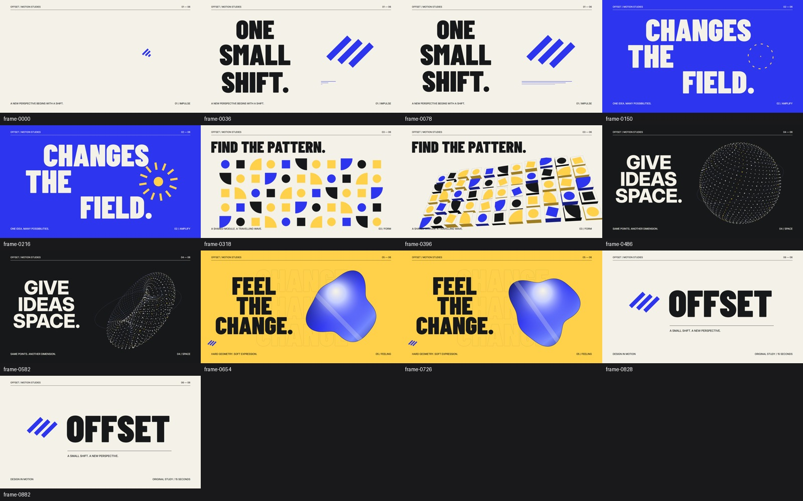

# Motion Design Director

[](LICENSE)
[](https://github.com/rohitrppatil9188/motion-design-director/actions/workflows/ci.yml)
[](https://nodejs.org/)

**A portable AI skill for directing and building original motion-design films.** It combines 50 individually written reference studies, 24 effect-construction recipes, deterministic animation helpers, original audio synthesis, rendering tools, and two editable examples.

Give a coding agent the complete repository and ask it to read [`SKILL.md`](SKILL.md). The skill helps it develop a concept, choose a typographic and geometric language, plan connected scenes, implement the motion, render a video, and inspect the result.

[](assets/example/rendered/offset.mp4)

[15-second OFFSET film](assets/example/rendered/offset.mp4) · [6-second FIELD NOTES film](assets/field-notes/rendered/field-notes.mp4) · [Effect recipes](references/effect-recipes.md) · [50 studies](references/study-index.md)

## How the skill works

The model reads **instructions, written visual analysis, recipes, and code**. It selects a few relevant studies and effects, then writes a new composition for your brief. The model's underlying weights remain unchanged. Original source videos are represented by analytical notes and links; they are not automatically watched or bundled.

The two original demonstration films, contact sheets, source projects, and numerical evidence are included. Visual inspection depends on the agent's tools. A text-only model can produce plans and code; an agent with file access, code execution, rendering and visual tools can complete the production loop.

```text
Brief → art direction → selected studies → shot plan → animation + sound
      → style frames → render → inspect and refine → MP4 + editable source
```

The research is a vocabulary for new work, not a requirement to reproduce a creator's branding or complete shot sequence. Strong results still depend on the model, the chosen renderer, and iteration.

## Use it with an AI model

Clone or download the repository, keep its supporting folders together, and use a brief like this:

> Read SKILL.md and the relevant supporting files. Create an original 15-second 1080p60 motion film for SIGNAL. Direction: precise editorial typography becomes an expressive geometric system. Use cream, ink and cobalt, two connected transformations, readable holds, original audio and a stable closing identity. Select relevant studies, make a shot plan, implement it, render and inspect the result, fix concrete issues, and deliver the MP4 with editable source.

The skill identifier and GitHub repository are both **`motion-design-director`**. Invoke the skill with `$motion-design-director`. For a skill-aware agent, copy the repository's skill files into a folder named `motion-design-director` in that agent's configured skills directory. For Codex's usual directory, this is `~/.codex/skills/motion-design-director`. Keep `.git`, `node_modules` and generated `out` directories out of the installed skill. Other agents can follow the files directly without a special installer.

Read [INSTALL.md](INSTALL.md) for setup, preview controls, rendering arguments, and troubleshooting. The entry file uses progressive loading: read the design guide, choose 2–4 studies, then read the recipes needed for the brief.

## Run the examples

Requirements: **Node.js 22+** (use a supported LTS release), **FFmpeg and FFprobe on PATH**, and Playwright's Chromium. No paid generation service or API key is required for the supplied examples.

```sh
git clone https://github.com/rohitrppatil9188/motion-design-director.git
cd motion-design-director
npm ci
npx playwright install chromium
npm test
npm run check
npm run verify
npm run demo
```

`npm run demo` creates a 15-second, 1920 × 1080, 60 fps H.264/AAC film with original synthesized stereo audio at `out/offset.mp4`. `npm run demo:field-notes` creates the second 6-second, 960 × 540, 30 fps example. Ready-to-play proof films are already present in each example's `rendered/` folder.

Verify a finished mux, including full decode and optional muted browser playback:

```sh
node scripts/verify-media.mjs --input out/offset.mp4 --width 1920 --height 1080 --fps 60 --duration 15 --frames 900 --require-audio --max-true-peak=-1.5 --playback
```

The renderer refuses to overwrite an existing MP4 unless you pass `--overwrite` explicitly. Use a new output directory when comparing versions. Audio is measured numerically; subjective listening must be performed separately.

## What's included

| Path | Purpose |
|---|---|
| [`SKILL.md`](SKILL.md) | Model entry point and production workflow |
| [`references/design-system.md`](references/design-system.md) | Direction, typography, composition, colour, material and pacing |
| [`references/effect-recipes.md`](references/effect-recipes.md) | 24 independent construction recipes, timings and failure checks |
| [`references/studies/`](references/studies/) | 50 film-specific written studies with source links |
| [`references/measurements/`](references/measurements/) | Native-frame CSV and audio signal evidence |
| [`scripts/`](scripts/) | Motion/mesh math, synthesis, rendering, verification and release checks |
| [`assets/example/`](assets/example/) | Original 15-second OFFSET project |
| [`assets/field-notes/`](assets/field-notes/) | Independently authored 6-second aperture/facet example |
| [`assets/templates/`](assets/templates/) | Shot-plan schema |
| [`assets/fonts/`](assets/fonts/) | Two OFL fonts, source/hash manifest and notices |

For technical details, see [architecture](docs/ARCHITECTURE.md), [contributing](CONTRIBUTING.md), [security](SECURITY.md), [release audit](docs/RELEASE_AUDIT.md) and [changelog](CHANGELOG.md).

## Research and validation boundaries

The 50 selected films were publicly attributed to Claude Opus 5.5 by the gallery, checked on **2026-10-29**. Model runs and original authorship were not independently verified. Two reposts in the initial set were replaced.

- **40,056 native frames** were decoded and numerically measured.
- **4,009 overview/transition tiles** were visually reviewed, with overlapping samples; this is not individual visual interpretation of every frame.
- Complete audio tracks received signal/loudness analysis; **no subjective listening** was performed.
- Exact original fonts, easing curves, source code and prompts were not recovered.
- A fresh model used the package to produce FIELD NOTES. This demonstrates usability for one brief, not universal improvement or guaranteed parity with the strongest references.

See [methodology](references/methodology.md) and [evaluation](references/evaluation.md) for the full record. Creator videos, source screenshots, prompts and soundtracks are not distributed in this repository. Measurements and links do not grant rights to the linked media.

## Licence and credits

Original code, documentation, analysis and demonstration assets are released under the **[MIT License](LICENSE)**, copyright © 2026 Rohit. Bundled Barlow Condensed and Inter fonts retain their **SIL Open Font License 1.1** notices. See [third-party notices](THIRD_PARTY_NOTICES.md) and each study for creator attribution. The project is independent and is not affiliated with or endorsed by the referenced model vendors, gallery, or creators.
